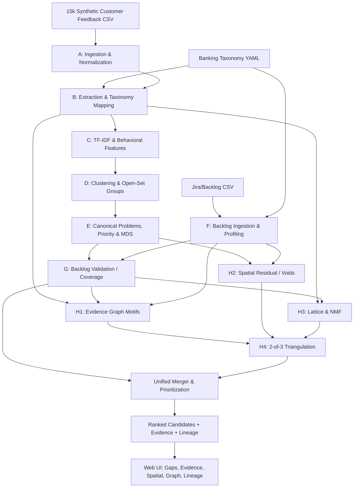

# Banking Customer Intelligence Platform — Complete Beginner & Business Guide

**Project location:** `/home/ltcctoiet/dev/analytics/new_implementation`  
**Main application:** `bci_platform/`  
**Document purpose:** Explain this entire project from scratch in plain language for a business stakeholder with very little technical knowledge, while also giving enough technical detail to understand how it really works.

> **Important note before you begin:** The sample feedback data and the sample backlog/Jira data included in this project are **synthetic (fake/test) data**. The system’s outputs are **evidence-backed analytical signals**, not automatic proof of root cause, not proof that a feature is missing, and not proof that an engineering ticket solved a customer problem.

---

## Table of Contents

1. [Executive Summary — What this project is in one page](#1-executive-summary--what-this-project-is-in-one-page)
2. [Why this project exists — the business problem](#2-why-this-project-exists--the-business-problem)
3. [What the project tries to achieve (and what it does NOT claim)](#3-what-the-project-tries-to-achieve-and-what-it-does-not-claim)
4. [Simple analogy — how to think about the system](#4-simple-analogy--how-to-think-about-the-system)
5. [What is inside the `new_implementation` folder](#5-what-is-inside-the-new_implementation-folder)
6. [The data used by the project](#6-the-data-used-by-the-project)
7. [The big picture — end-to-end flow from raw feedback to recommendations](#7-the-big-picture--end-to-end-flow-from-raw-feedback-to-recommendations)
8. [Key concepts explained in plain English (mini glossary inside the guide)](#8-key-concepts-explained-in-plain-english-mini-glossary-inside-the-guide)
9. [Module-by-module deep dive (A to H and Merger)](#9-module-by-module-deep-dive-a-to-h-and-merger)
   - [Module A — Ingestion & Normalization](#module-a--ingestion--normalization-the-front-door)
   - [Module B — Structured Signal Extraction & Taxonomy Mapping](#module-b--structured-signal-extraction--taxonomy-mapping-turning-stories-into-structured-facts)
   - [Module C — Weighted TF-IDF & Behavioral Representation](#module-c--weighted-tf-idf--behavioral-representation-turning-text-into-comparable-numbers)
   - [Module D — Clustering, Mega-Cluster Guard & Open-Set Grouping](#module-d--clustering-mega-cluster-guard--open-set-grouping-finding-natural-groups)
   - [Module E — Canonical Problems, Priority & MDS Layout](#module-e--canonical-problems-priority--mds-layout-creating-clear-problem-summaries)
   - [Module F — Backlog/Jira Ingestion & Profiling](#module-f--backlogjira-ingestion--profiling-understanding-planned-or-existing-work)
   - [Module G — Semantic Backlog Validation (Coverage Check)](#module-g--semantic-backlog-validation-coverage-check-is-this-problem-already-covered)
   - [Module H1 — Evidence Graph & Friction Motifs](#module-h1--evidence-graph--friction-motifs-finding-patterns-of-behavior-and-workarounds)
   - [Module H2 — Spatial Void / Residual Analysis (MDS + KDE)](#module-h2--spatial-void--residual-analysis-mds--kde-finding-crowded-pain-with-thin-coverage)
   - [Module H3 — Taxonomy Lattice & NMF (Combinatorial Patterns)](#module-h3--taxonomy-lattice--nmf-combinatorial-patterns-finding-hidden-high-effort-combinations)
   - [Module H4 — Triangulation (2-of-3 Lenses)](#module-h4--triangulation-2-of-3-lenses-promoting-only-corroborated-whitespace-signals)
   - [Unified Merger — Bringing everything into one prioritized list](#unified-merger--bringing-everything-into-one-prioritized-list)
10. [How scoring and prioritization work](#10-how-scoring-and-prioritization-work)
11. [Technical architecture — how the software is built](#11-technical-architecture--how-the-software-is-built)
12. [Database and stored information (plain-language view)](#12-database-and-stored-information-plain-language-view)
13. [Artifacts and traceability — how the system “shows its work”](#13-artifacts-and-traceability--how-the-system-shows-its-work)
14. [The user interface — what each screen means](#14-the-user-interface--what-each-screen-means)
15. [How to run the project](#15-how-to-run-the-project)
16. [How a business stakeholder should read and use the results](#16-how-a-business-stakeholder-should-read-and-use-the-results)
17. [Assumptions, limitations, and responsible interpretation](#17-assumptions-limitations-and-responsible-interpretation)
18. [Glossary of important terms](#18-glossary-of-important-terms)
19. [Final takeaway](#19-final-takeaway)

---

## 1. Executive Summary — What this project is in one page

This project is a **Banking Customer Intelligence & Product Opportunity Discovery platform**.

Its job is to read a large amount of **customer feedback** (for example: app reviews, complaints, survey comments, support-related feedback) and compare it against the company’s **backlog/Jira work items** (planned or tracked engineering/product tasks). From this, it tries to answer business questions like:

- **What problems are customers repeatedly facing?**
- **Which of those problems are already being addressed by existing backlog items, and which appear uncovered?**
- **Where is there “hidden” or structural friction** (customers using workarounds, getting stuck in journeys, or facing high-effort combinations of issues) that may point to product opportunities?
- **Which opportunities look most important**, based on evidence, customer effort, negativity, and volume?

It does this through a pipeline called **Modules A–H**:

- **A–B:** clean and understand feedback, extract structured signals (what happened, where, how customers felt, what they did instead).
- **C–E (Track 1 – Direct Gap Discovery):** group similar complaints, create clear “canonical problems,” and score their business priority.
- **F–G:** ingest backlog items and check whether those problems look covered, partially covered/unclear, or uncovered.
- **H1–H4 (Track 2 – Structural Whitespace Discovery):** look for deeper patterns using graphs, spatial maps, and behavioral combinations; promote a whitespace signal only when at least **2 out of 3** analytical lenses agree.
- **Unified Merger:** combine direct gaps and corroborated whitespace into one ranked, explainable list of candidates with evidence and lineage.

The result is shown in a web interface (overview, gap feed, spatial map, graph motifs, lineage, evidence drawer) so a person can **trace every recommendation back to the original customer feedback and the backlog comparison**.

---

## 2. Why this project exists — the business problem

### 2.1 The real-world challenge
Banks and digital product teams receive **thousands of customer comments** from many channels (mobile app, web, call/support notes, surveys, etc.). At the same time, engineering teams track work in systems like **Jira/backlogs**.

This creates several problems:

1. **Too much unstructured text:** Feedback is written in natural language. Different people describe the same issue in different words.
2. **Hard to see the true themes:** A dashboard showing raw counts or sentiment is not enough to understand *what* is broken, *where* in the journey, and *why* it matters.
3. **Backlog mismatch risk:** A ticket may sound related to a complaint, but that does not guarantee it actually solves the customer’s real pain. Conversely, some pains may have no meaningful backlog coverage.
4. **Hidden/structural friction:** Some important issues are not obvious single complaints. They show up as repeated workarounds (“I had to call support”), chains of failures, or high-effort combinations across journeys and channels.
5. **Need for explainability:** Leaders need to know *why* the system suggests an opportunity and be able to inspect the exact supporting customer evidence.

### 2.2 What business stakeholders want
- A **prioritized view** of customer problems/opportunities.
- Confidence that recommendations are **grounded in evidence** (actual feedback), not vague AI guesses.
- Visibility into **whether existing work appears to cover** those problems.
- A way to spot both **obvious gaps** and **less obvious structural whitespace**.
- A tool that supports **human review and decision-making**, not blind automation.

This project is designed to address those needs in a **local-first, auditable, evidence-traceable** way.

---

## 3. What the project tries to achieve (and what it does NOT claim)

### 3.1 What it aims to do
- **Consolidate feedback** into meaningful, deduplicated, structured records.
- **Extract signals** (intent, symptom, emotion, effort, journey, workaround, evidence quotes).
- **Discover direct problem clusters** and turn them into clear “canonical problems.”
- **Compare problems to backlog items** and label likely coverage relationships (covered / gray zone / uncovered) as **alignment signals**.
- **Detect structural whitespace signals** (graph motifs, spatial residual regions, high-effort low-coverage combinations/latent patterns).
- **Corroborate whitespace** by requiring agreement from at least 2 independent lenses (triangulation).
- **Merge and rank candidates** with decomposed scores and full traceability.
- **Provide a UI** to inspect gaps, evidence, spatial/graph views, and lineage.

### 3.2 What it does NOT claim (very important)
- It does **not** prove the **true root cause** of a problem.
- It does **not** prove that a **feature/capability is definitely missing** from the product.
- It does **not** prove that a Jira/backlog ticket has been **delivered, shipped, or resolved** the customer issue (ticket status is not proof of resolution).
- **Similarity/alignment is not the same as resolution/coverage.** A ticket can sound similar but solve something different—or solve it partially.
- **Spatial/graph/NMF/triangulation outputs are signals/candidates**, not ground truth. They highlight where to investigate.
- **LLM/judge outputs (if used)** are proposals/suggestions and should be reviewed by humans.
- With the bundled synthetic backlog and no real traffic denominators, some analyses (especially traffic-adjusted residual in H3) are **unavailable or heuristic**.

**Business takeaway:** Treat this platform as a **decision-support and discovery system** that points to evidence-backed opportunities for human validation.

---

## 4. Simple analogy — how to think about the system

Imagine a bank receives 15,000 customer letters/comments.

- **Module A** is like a mailroom: it receives, cleans, labels, removes obvious duplicates for counting, and files everything safely.
- **Module B** is like trained readers who highlight: *what the customer tried to do, what went wrong, where in the journey, how upset they were, and what workaround they used*, and they attach the exact quote as proof.
- **Modules C–E** are analysts who group similar letters into piles (clusters), give each pile a clear name (“International payment fails despite toggle on”), and estimate which piles matter most.
- **Modules F–G** are auditors who compare each problem pile to the engineering to-do list and ask: “Do we already have work that truly addresses this, or not?” (with caution).
- **Module H** is a detective team looking for deeper patterns: repeated escapes to call center, chains of issues over time, crowded “pain zones” with little planned work, and unusual high-effort combinations.
- **Triangulation** means the detective team only raises a special “hidden whitespace” flag when at least two different detective methods point to the same concern.
- **Unified merger/UI** produces one prioritized briefing book where every claim links back to the original letters and comparisons.

---

## 5. What is inside the `new_implementation` folder

At a high level:

- **`Banking_Customer_Intelligence_Detailed_Implementation_Guide.md`**  
  A long engineering/specification document describing the intended A–H architecture and implementation approach in detail.

- **`Project_Approach_Report_With_Visuals.md`**  
  A shorter, more visual/business-oriented explanation of the approach, rationale, and sample conceptual visuals.

- **`bci_platform/`**  
  The actual implemented platform (this is the runnable project). It contains:
  - **`backend/`** – Python backend: FastAPI API, database, pipeline orchestration, and all intelligence modules (A–H, merger).
  - **`frontend/`** – React + TypeScript web user interface.
  - **`taxonomy/`** – Banking taxonomy file (`banking_taxonomy_v1.yaml`) used to map feedback to banking journeys/features.
  - **`data/`** – Bundled input data and local runtime data (e.g. raw synthetic feedback CSV, synthetic backlog CSV, local SQLite DB under `data/local/`).
  - **`artifacts/`** – Per-run output files/reports/matrices/maps/manifests (the system’s saved “working papers”).
  - **`docs/`** – Architecture, data/assumption notes, and evaluation notes.
  - **`models/model_registry/`** – Placeholder area for model-related assets/registry (kept minimal in this implementation).
  - **`.env`, `.env.example`** – Configuration (paths, thresholds, keys, models, etc.).
  - **`README.md`** – Setup/run summary and high-level notes.

- **`PROJECT_BEGINNER_BUSINESS_GUIDE.md`** (this document)  
  A comprehensive plain-language + technical explainer for business stakeholders.

> **Constraint honored in this project:** The separate reference project at `/home/ltcctoiet/dev/analytics/voice-analytics/` was treated as read-only; assets were copied into `bci_platform` rather than modified there.

---

## 6. The data used by the project

### 6.1 Customer feedback data (input)
- **File (bundled):** `bci_platform/data/raw/feedback/synthetic_banking_app_feedback_15000.csv`
- **Nature:** Synthetic (fake/test) feedback, ~15,000 records, in a format similar to voice-analytics style data.
- **Typical fields mapped by the system include:**
  - `feedback_id` – unique identifier for the feedback record
  - `feedback_text` – the raw customer comment (main text)
  - `submitted_at` – when it was submitted (timestamp)
  - `source_channel` – where it came from (e.g. app, web, etc.)
  - `synthetic_customer_ref` – a customer reference (synthetic)
  - `rating_1_to_5` – rating score if present
  - `platform`, `language` – device/platform/language context if present
  - `customer_tier` – may be missing/unknown in many cases

### 6.2 Backlog / Jira-like data (input)
- **File (bundled):** `bci_platform/data/raw/jira/sample_backlog_upload.csv`
- **Nature:** Synthetic backlog treated as a Jira-export baseline (not a live Jira connection, and not proof of delivery).
- **Typical fields:** backlog/issue id, title, description, status, issue type, priority, product area, acceptance criteria, etc. (as available).

### 6.3 Banking taxonomy (reference/knowledge structure)
- **File:** `bci_platform/taxonomy/banking_taxonomy_v1.yaml`
- **What it is:** A structured hierarchy of banking journeys/features/stages (e.g. accounts, cards, payments, login, notifications, etc.) with names, descriptions, synonyms/signature paths.
- **Why it matters:** Helps the system map messy customer language to consistent banking journey nodes (so similar issues can be compared and organized).

### 6.4 Configuration and environment
- **Files:** `.env`, `backend/app/config.py`
- **Controls:** input file paths, database/artifact locations, thresholds (clustering, coverage, triangulation), model/provider settings (e.g. optional Gemini), random seed, and other runtime behavior.
- **Secret handling:** API keys should be kept in `.env` and not exposed in artifacts/snapshots.

---

## 7. The big picture — end-to-end flow from raw feedback to recommendations

Think of the pipeline as a sequence of steps. Each step reads from previous results (database/artifacts) and writes its own outputs.



**Plain-language reading of the flow:**
1. **A** brings feedback in cleanly.
2. **B** understands each feedback and structures it.
3. **C–E** find and summarize recurring problems (direct discovery).
4. **F–G** compare those problems to backlog items (coverage/alignment signals).
5. **H1–H3** look for structural/hidden patterns from different angles.
6. **H4** keeps whitespace signals only when at least two angles agree.
7. **Merger/UI** present one evidence-backed, prioritized view for humans.

**Execution order in this implementation:** `A → B → C → D → E → F → G → H1 → H2 → H3 → H4 → Unified Merger` (sequential, so each step has the inputs it needs).

---

## 8. Key concepts explained in plain English (mini glossary inside the guide)

| Concept | Plain-English meaning | Why it matters here |
|---|---|---|
| **Canonical problem** | A cleaned-up, standardized summary of a recurring customer problem (built from a cluster of similar feedback). | Turns many noisy comments into a clear issue stakeholders can discuss and prioritize. |
| **Cluster** | A group of feedback records that look similar to each other. | Helps find repeated themes without reading every record manually. |
| **Taxonomy / journey node** | A structured map of banking areas (e.g. Cards > International Usage). | Gives consistent business context to feedback. |
| **Evidence span** | The exact piece of original text that supports an extracted claim. | Makes outputs auditable and trustworthy (“show me the quote”). |
| **TF-IDF** | A way to represent text by emphasizing words/phrases that are important in a record but not common everywhere. | Lets the system compare and group feedback by meaningful language. |
| **SVD (dimensionality reduction)** | A math technique to compress many text features into fewer, denser dimensions while keeping main patterns. | Makes clustering more practical/stable on high-dimensional text vectors. |
| **HDBSCAN** | A clustering algorithm that finds groups of varying shapes/sizes and can label outliers as “noise.” | Useful when you don’t know how many problem clusters exist in advance. |
| **Cosine similarity** | A measure of how similar two text representations are (by angle/direction), often from 0 to 1. | Used to compare problems to backlog items (alignment signal). |
| **MDS (Multidimensional Scaling)** | A method to place items on a 2D map so that similar items are closer together. | Powers the spatial view of problem landscape. |
| **KDE (Kernel Density Estimation)** | A way to estimate “hotspot intensity” over a map from points. | Used to estimate pain concentration and backlog coverage surfaces. |
| **NMF (Non-negative Matrix Factorization)** | A method that finds additive latent patterns/components in non-negative data. | Helps surface co-occurring behavioral patterns (interpreted cautiously). |
| **Graph motif** | A recurring pattern of connections in a network (e.g. issue → workaround escape). | Reveals structural/friction behaviors, not just text similarity. |
| **Triangulation** | Requiring agreement from multiple independent lenses before promoting a signal. | Reduces false positives from any single heuristic method. |
| **Lineage** | The traceable path from raw feedback → extracted signals → analysis → candidate → backlog audit. | Core to explainability and trust. |

---

## 9. Module-by-module deep dive (A to H and Merger)

Below, each module is explained in the same structure:
- **Business purpose** (why it exists)
- **Inputs** (what it reads)
- **How it works** (step-by-step, including algorithms/logic)
- **Outputs** (what it produces)
- **How to interpret it** (business meaning)
- **Limitations/cautions**

---

### Module A — Ingestion & Normalization (the “front door”)

#### Business purpose
Before any analysis, the system must reliably bring in raw feedback, keep the original truth, clean it safely, protect privacy where possible, and handle duplicates sensibly. If ingestion is wrong, everything downstream is wrong.

#### Inputs
- Feedback CSV (e.g. `synthetic_banking_app_feedback_15000.csv`)
- Configuration (paths, duplicate thresholds/window, salt for hashing, etc.)

#### How it works (step-by-step)
1. **Load source file:** Reads the CSV (all as text initially) and maps known source columns to canonical fields (e.g. `feedback_text`→raw text, `submitted_at`→timestamp, `source_channel`→channel, `synthetic_customer_ref`→customer id, etc.).
2. **Validate each row:** 
   - Ensures required text exists and is not too short/empty.
   - Rows that fail basic checks are marked **rejected** with a reason (but still recorded for audit) and written to a rejected-rows report.
3. **Normalize text:** Trims/standardizes whitespace and removes invisible characters while preserving meaning (including negation/numbers) as much as possible.
4. **Parse timestamps:** Converts timestamps to a consistent UTC/ISO form when possible; missing/unparseable timestamps are handled gracefully and reported.
5. **Privacy-aware handling (PII redaction on cleaned text):** Uses pattern matching to detect/redact certain sensitive patterns (e.g. emails, phone-like numbers, card-like numbers, UPI/account-like patterns) in the cleaned text, and records PII flags/types. **Original raw text is preserved** for traceability; redaction is applied to cleaned/processed forms used in analysis.
6. **Pseudonymous customer hashing:** If a customer reference exists, it is converted to a hashed/pseudonymous value (with a salt) rather than stored as plain identifier in the analytical flow.
7. **Near-duplicate grouping (no deletion):**
   - Creates lightweight text “shingles” (small word sequences) for records.
   - Compares records (primarily within the same customer and within a configured time window) using **Jaccard similarity** of shingles.
   - If similarity is above a threshold, records are grouped into a duplicate group.
   - Picks one **representative** record per group (e.g. earliest timestamp/source order) but **keeps all members** (no destructive deletion).
   - *Why:* avoids double-counting the same complaint while preserving full evidence.
8. **Persist and report:** Stores accepted/rejected feedback records in the database and writes ingestion quality/reject artifacts.

#### Outputs
- Database rows in `feedback_records` (raw + cleaned text, status, timestamps, hashes, duplicate group info, PII flags, etc.)
- Artifacts/reports such as ingestion quality report and rejected rows CSV
- Run/module status and counts updated

#### How to interpret it
- High rejection rates or many missing fields may indicate source data quality issues.
- Duplicate grouping affects downstream volume signals (representatives are often used for modeling), but evidence remains traceable.

#### Limitations/cautions
- PII detection is pattern-based and not perfect; treat as a safeguard, not a guarantee.
- Timestamp/customer missingness can affect time-window duplicate logic (the system uses conservative/fallback behavior and reports it).
- Synthetic data may not reflect real-world noise distributions.

---

### Module B — Structured Signal Extraction & Taxonomy Mapping (turning stories into structured facts)

#### Business purpose
Raw feedback is unstructured. To analyze at scale, we need consistent fields: *what the customer wanted (intent), what went wrong (symptom), where in the banking journey it happened, how they felt, how hard it was, what workaround they used,* and *the exact evidence quote*.

#### Inputs
- Accepted feedback from Module A (`feedback_records`)
- Banking taxonomy (`banking_taxonomy_v1.yaml`)
- Extraction/taxonomy settings

#### How it works (step-by-step)
1. **Load taxonomy:** Reads taxonomy nodes (modules/features/stages, descriptions, synonyms/signature paths, versions) and stores/uses them for mapping.
2. **For each accepted feedback record, detect key signals (rule-based/provisional implementation):**
   - **Intent detection:** Matches keywords/phrases against intent patterns (e.g. payment, login/access, check balance, manage card, get support, update profile). Picks the best-matching intent with a confidence score.
   - **Symptom detection:** Matches patterns like failed/declined/error, slow/delay, confusing/missing, charged/deducted, crash/freeze.
   - **Emotion detection:** Matches patterns indicating anger, anxiety, sadness, satisfaction (or neutral default).
   - **Sentiment score:** Computes a simple normalized score (roughly -1 to +1) based on presence/balance of negative vs positive cue words.
   - **Effort score:** Estimates customer effort (e.g. ~1–5 scale) using cues such as “waiting,” “call,” “branch,” “again,” “urgent” (increase) and ease/satisfaction cues (decrease).
   - **Outcome:** Infers rough outcome (resolved/unresolved/unknown) from outcome-related words.
   - **Workarounds:** Detects explicit workaround tags (e.g. `BRANCH_VISIT`, `CALL_CENTER`, `MANUAL_EXPORT`, `SCREENSHOT_PROOF`, `THIRD_PARTY_CHAT`) when matching phrases appear.
3. **Evidence span (verifiable quote):**
   - Tries to locate a supporting phrase (prefer symptom phrase, else intent phrase, else fallback slice) in the original/raw text and records start/end positions when possible.
   - Falls back to a guaranteed slice of raw text if exact matching is tricky, so every insight still carries traceable evidence.
   - *Why:* stakeholders should be able to see the exact words behind a label.
4. **Taxonomy/journey mapping (with open-set handling):**
   - Maps the cleaned text to the most relevant taxonomy/journey node using text/signature matching logic and a confidence threshold.
   - If confidence is low, marks as **open-set** (i.e. does not neatly fit known taxonomy) rather than forcing a bad fit.
   - Records top candidates/confidence context.
5. **Build enriched representation:**
   - Creates an **enriched sentence** (template/deterministic form) combining journey/signature path, symptom, and the cleaned statement. This is used later for comparison/clustering.
6. **Persist insights and taxonomy nodes:** Writes one structured insight per feedback record (with confidences, model/taxonomy versions, status/errors if any) and updates taxonomy tables.
7. **Quality reporting:** Produces extraction quality metrics (counts, open-set rate, evidence coverage, notes on implementation mode).

#### Outputs
- `extracted_insights` records (intent, aspect, symptom, sentiment, emotion, effort, outcome, workarounds, journey node/confidence, evidence span/start/end, enriched sentence, open-set flag, confidences, versions)
- `taxonomy_nodes` persisted/available
- Extraction quality report artifact

#### How to interpret it
- This module turns qualitative feedback into analyzable fields while preserving evidence.
- **Open-set** items are important: they may represent emerging issues not yet well captured by taxonomy.

#### Limitations/cautions
- **Deterministic rule-based/provisional extractor:** auditable and transparent, but not the same as a fully trained/validated BERT/LLM extraction suite. It can miss nuance, sarcasm, complex phrasing, or domain-specific language.
- Keyword-based detection may produce imperfect labels; confidence fields and evidence spans help reviewers judge quality.
- Workaround detection depends on explicit mentions in text.

> **Technical note:** The broader spec envisions richer NLP models (e.g. fine-tuned BERT tasks, confidence calibration). The current implementation provides a working, auditable baseline with the same structural outputs and traceability.

---

### Module C — Weighted TF-IDF & Behavioral Representation (turning text into comparable numbers)

#### Business purpose
Computers cannot directly “compare meanings” of sentences the way humans do without converting them into numerical representations. Module C creates representations so similar problems can be grouped and compared later.

#### Inputs
- Extracted insights (Module B)
- Feedback records (for cleaned text, customer/tier/duplicate info)
- Taxonomy signature paths

#### How it works (step-by-step)
1. **Select representative insights:** Uses representative accepted insights (e.g. one per duplicate group, plus non-duplicates) to avoid over-weighting repeated near-identical feedback in modeling. (Full membership remains in the database for evidence.)
2. **Build three text views per insight:**
   - **Signature/taxonomy text** (journey/signature path context)
   - **Symptom text**
   - **Main text** (cleaned text or enriched sentence)
3. **Vectorize each view with TF-IDF:**
   - **TF-IDF** (Term Frequency–Inverse Document Frequency) gives higher weight to terms that are distinctive for a record and lower weight to very common terms.
   - Uses word/phrase n-grams (e.g. unigrams/bigrams), sublinear term frequency, English stop-word handling, and feature caps for efficiency.
4. **Combine with weights (weighted TF-IDF):**
   - Final text feature vector = **0.40 × signature/taxonomy** + **0.35 × symptom** + **0.25 × main text**.
   - *Why this weighting (business logic):* where the issue occurs (journey) and what the symptom is are often more diagnostic than raw wording alone.
   - Vectors are normalized for consistent similarity behavior.
5. **Save matrix artifacts:** Stores the sparse TF-IDF matrix, insight ID list, and vectorizer/metadata (including vocabulary sizes and weights).
6. **Build behavioral feature table:** For each representative insight, captures behavioral/categorical attributes used in later analysis (e.g. journey node, symptom, emotion, scaled/raw effort, sentiment, tier, intent, open-set flag). 
7. **Distance strategy (scalable):** Instead of materializing a huge full pairwise distance matrix in memory, records a manifest indicating on-demand/blockwise distance computation strategy for behavioral/Gower-like comparisons where needed.

#### Outputs
- Artifacts: `direct/tfidf_matrix.npz`, `direct/insight_ids.json`, `direct/vectorizer_metadata.json`, `direct/behavioral_features.json`, `direct/distance_manifest.json`
- Module status/metadata (shape, weights, etc.)

#### How to interpret it
- This is a **mathematical preparation step**. It does not create business recommendations by itself, but it enables clustering and spatial analysis.
- The chosen weights influence what “similar” means (more emphasis on taxonomy/symptom vs raw text).

#### Limitations/cautions
- TF-IDF captures word/phrase overlap patterns, not deep semantic understanding like modern embedding models can. (The architecture allows stronger embeddings later; this implementation provides a local deterministic baseline.)
- Language quality, spelling variation, and mixed phrasing can affect representation quality.

---

### Module D — Clustering, Mega-Cluster Guard & Open-Set Grouping (finding natural groups)

#### Business purpose
With thousands of feedback items, we need to group similar ones into themes/problems automatically. Clustering helps answer: “What are the recurring buckets of customer pain?”

#### Inputs
- TF-IDF matrix and insight IDs (Module C artifacts)
- Behavioral features (Module C)
- Clustering parameters (min cluster size, min samples, SVD components, mega-cluster fraction, open-set thresholds, seed)

#### How it works (step-by-step)
1. **Dimensionality reduction with SVD:**
   - TF-IDF vectors can be very wide (many features). **Truncated SVD** compresses them into fewer components (e.g. up to ~100) while preserving major structure.
   - Resulting vectors are normalized.
   - *Plain English:* reduce complexity so clustering is faster and less noisy.
2. **Primary clustering (HDBSCAN, with fallback):**
   - **Preferred:** `HDBSCAN` (Hierarchical Density-Based Spatial Clustering of Applications with Noise).
     - Finds clusters of varying density/shape.
     - Does **not** require pre-specifying the number of clusters.
     - Marks outliers as **noise** (label -1).
   - **Fallback:** If HDBSCAN is unavailable/fails, uses `MiniBatchKMeans` as a baseline (simpler partitioning).
   - The method used is recorded in reports for transparency.
3. **Mega-cluster guard (split overly large clusters):**
   - If any single cluster becomes too large (above a configured fraction of data, and large enough), it is split into smaller sub-clusters (using MiniBatchKMeans on that subset).
   - *Why:* prevents one giant “miscellaneous” bucket from hiding meaningful sub-themes.
4. **Build cluster memberships:** Assigns each insight to a cluster (or noise) and stores memberships in the database.
5. **Open-set micro-grouping (additive):**
   - Identifies insights that are open-set (taxonomy-unmapped/low-fit) or high-effort noise/outliers.
   - Groups them by `(intent, symptom)` keys.
   - Keeps groups that meet a minimum count threshold as **open-set micro-clusters** (additive labels) so emerging/unusual but repeated issues are not lost.
6. **Reporting and counts:** Writes cluster/open-set reports and updates run counts.

#### Outputs
- `cluster_memberships` in DB (including noise and open-set group memberships)
- Artifacts: `direct/clusters_report.json`, `direct/open_set_groups.json`
- Counts (clusters/open-set groups) and method/parameter transparency

#### How to interpret it
- Clusters are **candidate themes**, not guaranteed final truth. They are inputs to canonical problem creation.
- **Noise** means “not confidently placed in a dense cluster” (not necessarily unimportant, especially if high-effort/open-set).
- Open-set micro-groups can surface novel or poorly-taxonomized issues.

#### Limitations/cautions
- Clustering quality depends on representation quality, parameters, and data diversity.
- Different algorithms/parameters can produce different groupings (sensitivity matters).
- KMeans fallback is less aligned with “density + noise” behavior than HDBSCAN.

---

### Module E — Canonical Problems, Priority & MDS Layout (creating clear problem summaries)

#### Business purpose
Clusters are technical groupings. Business stakeholders need **clear, named problems** with representative evidence, volume/effort context, and a priority signal. Module E converts clusters into **canonical problems**.

#### Inputs
- Cluster memberships (Module D)
- TF-IDF vectors/insight IDs (Module C artifacts)
- Extracted insights and feedback details (for evidence, effort, sentiment, tiers, journeys)
- Priority/MDS settings

#### How it works (step-by-step)
1. **Collect members per cluster:** Builds unique insight/member lists for each cluster (skipping tiny/noise-only buckets except meaningful open-set cases).
2. **Compute a cluster centroid (center point):**
   - Takes the mean of member vectors in TF-IDF space as the cluster’s center.
3. **Choose a representative (“medoid-like” centroid-nearest item):**
   - Finds the member closest to the centroid (by distance in TF-IDF space).
   - Uses that representative to anchor title/text/evidence examples.
   - *Implementation note:* documented as centroid-nearest representative (a practical medoid proxy).
4. **Aggregate cluster statistics:**
   - Member/feedback counts, mean effort, negative sentiment share, customer tier distribution (over known tiers), missing-tier share, journey/signature context.
   - Extracts keyword proxies from common symptom/signature tokens for labeling support.
5. **Generate labels and problem statement:**
   - Creates a deterministic title/label/problem statement (e.g. based on representative symptom and journey/signature + keywords).
   - Stores both deterministic label and fields for potential future LLM label enrichment (LLM label may be null in this baseline).
6. **Compute priority score (decomposed):**
   - Combines normalized components (see [Section 10](#10-how-scoring-and-prioritization-work)):
     - **Volume** (log-scaled frequency)
     - **Effort** (mean effort)
     - **Negativity/Sentiment** (share of negative sentiment)
     - **Tier impact** (share of high-value tiers among known tiers)
   - Produces a 0–100 style priority plus component breakdown (so stakeholders can see *why*).
7. **Attach top evidence:** Stores representative/top evidence snippets and supporting feedback IDs for traceability.
8. **Create 2D layout with MDS (for spatial/visual context):**
   - Builds a cosine-distance matrix between cluster centroids (TF-IDF centroid space) and applies **MDS** to place problems on a 2D map where similar problems are closer.
   - Stores coordinates and MDS stress (a fit/distortion indicator) when available.
   - *Purpose:* supports spatial visualization and H2 analysis; axes are **relative analytical dimensions**, not business axes.
9. **Persist canonical problems:** Saves problem records in `canonical_problems` with all metadata, scores, evidence, and MDS coordinates.

#### Outputs
- `canonical_problems` in DB (IDs, titles/statements, labels, representative evidence, counts, scores, MDS coords, open-set flags, supporting feedback IDs)
- Artifacts: `direct/canonical_problems.json`, `direct/mds_coordinates.json`

#### How to interpret it
- A canonical problem is the system’s **best structured summary** of a recurring issue cluster.
- Priority is a **ranking aid**, not an automatic investment decision; inspect components and evidence.
- MDS position is useful for relative similarity exploration, but distances/voids are approximate.

#### Limitations/cautions
- Labels are heuristic/deterministic summaries and may need human refinement.
- Priority depends on available fields (e.g. tiers may be missing; component breakdown records missingness behavior).
- MDS on centroid cosine distances is a baseline/proxy (not a perfect representation of all behavioral nuance) and can distort relationships.

---

### Module F — Backlog/Jira Ingestion & Profiling (understanding planned or existing work)

#### Business purpose
To know whether a customer problem is “already being worked on,” the system needs a structured understanding of backlog items. Module F ingests backlog data and builds searchable/profiled representations.

#### Inputs
- Backlog/Jira CSV (e.g. `sample_backlog_upload.csv`)
- Taxonomy (for journey mapping)
- Settings

#### How it works (step-by-step)
1. **Load backlog source:** Reads the CSV (treated as a Jira-export baseline/synthetic source in this setup). If missing, continues with an empty backlog and records that state.
2. **Map and normalize fields:** Extracts identifiers, title, description, status, issue type, priority, product area/components, acceptance criteria, and other metadata as available.
3. **Create searchable text:** Concatenates relevant fields (title, description, acceptance criteria, product area, etc.) into a single searchable/profile text per item.
4. **Profile the item (lightweight):**
   - Maps searchable text to a likely **journey node** via taxonomy (with confidence) where possible.
   - Extracts simple intent/aspect cues (e.g. fix/improve/add/show/reduce/enable/support keywords).
   - Stores profile/confidence metadata and content hashes/model-version markers.
5. **Persist backlog items:** Writes records into `backlog_items` with raw + searchable/profiled fields and provenance.

#### Outputs
- `backlog_items` in DB
- Artifact/report: `direct/backlog_ingestion_report.json`

#### How to interpret it
- Backlog profiling enables later comparison against customer problems.
- Status fields (e.g. To Do/In Progress/Done) are **tracked states**, not proof that customer pain is resolved.

#### Limitations/cautions
- Quality depends heavily on backlog text quality/completeness.
- Synthetic/sample backlog may not reflect real engineering scope or delivery reality.

---

### Module G — Semantic Backlog Validation (Coverage Check: is this problem already covered?)

#### Business purpose
This is the “audit” step: for each canonical problem, find the most similar backlog items and estimate whether the problem appears **covered, in a gray zone, or uncovered**. This helps prioritize true gaps while avoiding duplicate work.

#### Inputs
- Canonical problems (Module E)
- Backlog items (Module F)
- Coverage thresholds and settings (covered/gray lower/top-k)
- Optional LLM judge configuration (Gemini) if cloud calls allowed

#### How it works (step-by-step)
1. **Build comparable text representations (local semantic proxy):**
   - For each backlog item: uses searchable text (title/description/acceptance criteria/product area).
   - For each problem: combines title/problem statement and top evidence/enriched snippets.
   - Uses **TF-IDF vectorization + normalization** as a local, deterministic semantic similarity proxy (baseline).
2. **Compute similarity and retrieve top-k backlog candidates per problem:**
   - Calculates **cosine similarity** between problem vectors and backlog vectors.
   - Selects top-k closest backlog items with similarity scores/ranks.
3. **Apply 3-tier coverage logic (threshold-based, configurable):**
   - **COVERED (alignment signal):** best similarity >= covered threshold (e.g. 0.75 by default)
   - **GRAY ZONE / PARTIAL:** between gray lower and covered (e.g. 0.60–0.75)
   - **UNCOVERED_GAP:** below gray lower threshold
   - *Important:* these are **alignment/similarity signals**, not proof of actual resolution.
4. **Gray-zone handling (judge/proposal, cautious):**
   - For gray-zone cases, the system may attempt a **judge** step.
   - If Gemini/cloud judge is enabled and available, it can request a structured judgment (covered true/false, best ticket among supplied candidates, reason) emphasizing “similarity ≠ resolution.”
   - If unavailable or errors occur, it marks the case as **unverified/needs review** (safe fallback).
5. **Persist findings and matches:**
   - Stores per-problem validation findings (relationship type, best ticket, alignment score, confidence, reason, judge decision/status, metadata).
   - Stores top backlog-problem match records with ranks/scores.

#### Outputs
- `validation_findings` and `backlog_problem_matches` in DB
- Artifact/report: `direct/backlog_matches.json` (counts: covered/gray/uncovered, etc.)

#### How to interpret it
- **UNCOVERED_GAP:** no strong textual/alignment match found in backlog (candidate for attention).
- **GRAY ZONE:** related items exist, but relationship is unclear—needs human/product review.
- **COVERED (by alignment):** backlog appears topically aligned; still verify whether scope actually resolves the customer pain.

#### Limitations/cautions
- Uses TF-IDF similarity proxy in this implementation (not a guaranteed deep semantic match).
- Backlog text can be vague/incomplete, causing false negatives or false positives.
- Ticket status and wording are not delivery/outcome proof.
- LLM judgments are assistive proposals and may be unavailable/unverified.

---

### Module H1 — Evidence Graph & Friction Motifs (finding patterns of behavior and workarounds)

#### Business purpose
Some problems are best understood as **patterns of behavior**, not just similar sentences. H1 builds an evidence graph to detect structural friction motifs such as workaround escapes, temporal chains, and bridge nodes.

#### Inputs
- Extracted insights and feedback context (journey, intent, aspect, symptom, workarounds, effort, customer hash, timestamps)
- Validation/findings and canonical problem support (for coverage/addressed signals)
- Graph settings (followed-by window days, support thresholds, addressed-by thresholds)

#### How it works (step-by-step)
1. **Build graph nodes and edges from evidence:**
   - **Nodes** represent entities such as journey nodes, intents, aspects, symptoms, workarounds, and (when relevant) backlog items.
   - **Edges** represent evidence-backed relationships, for example:
     - **CO_OCCURS:** elements appear together in the same feedback (association within evidence)
     - **ESCAPES_TO:** intent/journey leads to a workaround in the same feedback
     - **WORKAROUND_OF:** symptom related to workaround in same feedback (explicit evidence relation)
     - **FOLLOWED_BY:** one symptom followed by another for the same (hashed) customer within a time window (temporal association, **not causation**)
     - **ADDRESSED_BY:** provisional linkage from problem/intent/journey context to best-matching backlog item when alignment/coverage signals meet thresholds (provisional, similarity-informed)
2. **Detect motifs (pattern detectors):**
   - **Motif 1: Workaround escape**  
     Finds patterns like intent/symptom leading to workarounds (e.g. call center/branch/manual steps) where the intent does not appear addressed by backlog. Aggregates counts, mean effort, and supporting feedback IDs.
   - **Motif 2: Temporal friction chain**  
     Finds symptom A followed by symptom B within the configured window with sufficient support/lift (association strength) and where downstream appears not addressed. Stores transition evidence and notes association-not-causation.
   - **Motif 3: Bridge nodes**  
     Projects to relevant node types (e.g. journey/aspect) and computes **betweenness centrality** (a measure of how often a node lies on paths between others). High-centrality nodes with weak addressed coverage are flagged as structural bridge candidates.
3. **Score and normalize detections:** Computes raw and normalized scores within detector types for comparability.
4. **Persist detections and graph artifacts:** Stores lens detections in DB and writes graph/motif artifacts (with truncation safeguards for large graphs).

#### Outputs
- `lens_detections` rows for graph motifs
- Artifacts: `graph/motifs.json`, `graph/graph.json` (summary/sample edges, counts)

#### How to interpret it
- High-effort workaround escapes can indicate process/product friction forcing customers out of the intended flow.
- Temporal chains suggest possible cascades/journeys of pain (but require validation before calling them causal).
- Bridge nodes can reveal structurally important journey/aspect points affecting many paths.

#### Limitations/cautions
- **Correlation/association is not causation.** `FOLLOWED_BY` does not prove A caused B.
- `ADDRESSED_BY` links may be provisional and similarity-informed.
- Graph quality depends on extraction quality, timestamp/customer availability, and thresholds.

---

### Module H2 — Spatial Void / Residual Analysis (MDS + KDE: finding crowded pain with thin coverage)

#### Business purpose
H2 asks: *On a map of related customer problems, where is pain concentrated but backlog coverage appears thin?* This can highlight “white space” regions worth investigating.

#### Inputs
- Canonical problems with MDS coordinates and priority/effort/supporting feedback (Module E)
- Backlog items (Module F)
- Spatial settings (grid size, backlog factor, etc.)

#### How it works (step-by-step)
1. **Check readiness:** Requires enough problem points with coordinates; otherwise skips with explanation.
2. **Use problem positions as the “pain landscape” base:**
   - Takes 2D MDS coordinates of canonical problems.
   - Assigns each problem a weight based on business-relevant signals (e.g. priority and effort influence) so more important/intense problems contribute more to “pain.”
3. **Estimate pain density with KDE:**
   - **KDE (Kernel Density Estimation)** spreads each problem point into a smooth “hill” and sums them over a grid to estimate where pain is concentrated.
   - Produces a pain surface over a 2D grid.
4. **Project backlog onto the same space (heuristic) and estimate backlog density:**
   - Backlog items do not naturally have the same MDS coordinates.
   - The implementation uses a **heuristic projection**: place a backlog item near problems of the same journey (mean position), else near the global mean, with a weight.
   - Runs KDE on projected backlog points to estimate a backlog/coverage surface.
   - *Important:* this is an approximation for exploratory analysis.
5. **Normalize and compute residual (“void”) surface:**
   - Normalizes pain and backlog surfaces (e.g. min-max baseline).
   - Computes residual = `max(0, pain_normalized - backlog_factor * backlog_normalized)`.
   - High residual means: **relatively high pain signal and relatively low backlog presence in that region** (under this heuristic model).
6. **Detect peaks/regions:**
   - Finds local maxima above a threshold as candidate “void/residual regions.”
   - Collects supporting problems/feedback within a radius around each detected region.
7. **Persist detections and map artifacts:** Stores spatial lens detections and writes a spatial map artifact (including sampled surfaces and method notes).

#### Outputs
- `lens_detections` for spatial void regions
- Artifact: `spatial/spatial_map.json` (grid, residual info, sampled surfaces, detections, method metadata)
- UI data for interactive spatial map (points + overlay)

#### How to interpret it
- A highlighted region suggests “investigate here” — there may be concentrated pain with weak backlog alignment nearby.
- Useful for discovery conversations and hypothesis generation.

#### Limitations/cautions
- **Heuristic, not proof.** MDS distortion, projection choices, bandwidth/grid choices, and normalization can create artifacts.
- Axes are abstract/relative, not literal business dimensions.
- Sparse/uneven data can mislead; results should be validated against evidence and domain knowledge.

---

### Module H3 — Taxonomy Lattice & NMF (Combinatorial Patterns: finding hidden high-effort combinations)

#### Business purpose
Some opportunities emerge from **combinations**: a specific journey + intent that repeatedly causes high effort, or latent behavioral patterns (intent/symptom/emotion/channel/workaround) that recur together but are not obviously covered. H3 looks for these combinatorial signals.

#### Inputs
- Extracted insights + feedback/taxonomy context (journey, intent, symptom, emotion, effort, workarounds, channel, etc.)
- Validation findings and problem-journey mappings (for backlog alignment/coverage context)
- NMF/component and threshold settings

#### How it works (step-by-step)

**Part A: Journey × Intent lattice (explicit combinations)**
1. **Aggregate by (journey node, intent):** Counts feedback, collects effort values and supporting feedback IDs per cell.
2. **Bring in backlog alignment context:** Uses best available problem/backlog alignment signals for the journey (as an approximation of coverage context).
3. **Flag candidate lattice holes/gaps (heuristic):** Selects cells that meet criteria such as:
   - sufficient count (e.g. >= 10)
   - high mean effort (e.g. >= 3.8)
   - low backlog alignment (e.g. < 0.25)
   - *Interpretation:* repeated, high-effort journey-intent combinations that appear weakly aligned to backlog.

**Part B: NMF latent behavioral components (co-occurrence patterns)**
1. **Build a non-negative behavioral feature matrix:** One-hot/count indicators for features like intent, symptom, emotion, channel, and workaround tags per insight.
2. **Factorize with NMF:**
   - **NMF** decomposes the matrix into:
     - **W:** how strongly each feedback/insight belongs to each latent component
     - **H:** which features define each component
   - Components are additive patterns (e.g. a component may heavily weight “payment decline + high effort + call center + anxiety”).
3. **Evaluate components for candidate signals:**
   - For each component, inspects top member records/features.
   - Flags components with high mean effort and low covered-share (based on available problem/backlog coverage mapping) as potential high-friction, weakly covered patterns.
   - Stores top features, stats, and supporting feedback.
4. **Traffic-adjusted residual status:**
   - The spec concept may include traffic-adjusted expected vs observed analysis, but this implementation explicitly reports **traffic-adjusted residual as unavailable** because no real channel/journey traffic denominators are provided.

#### Outputs
- `lens_detections` for lattice holes and selected NMF components
- Artifact: `combinatorial/lattice_nmf.json` (lattice candidates, NMF info, detection counts, traffic-residual unavailable note)

#### How to interpret it
- Lattice candidates point to concrete journey-intent areas with repeated high effort and weak apparent backlog alignment.
- NMF components suggest **co-occurring behavioral themes** to investigate; they are not automatically “real segments” or product requirements.

#### Limitations/cautions
- Threshold-driven heuristics can produce false positives/negatives.
- NMF components depend on feature construction and number of components; stability/interpretability must be validated.
- Coverage/effort aggregation at journey/component level is approximate.
- No real traffic denominators → traffic-adjusted residual cannot be computed reliably here.

---

### Module H4 — Triangulation (2-of-3 lenses: promoting only corroborated whitespace signals)

#### Business purpose
H1, H2, and H3 each use different methods and can each be noisy. Triangulation increases confidence by promoting a whitespace candidate only when **at least two independent lenses** support a related signal.

#### Inputs
- Lens detections from H1 (graph), H2 (spatial), H3 (combinatorial)
- Canonical problems and validation findings (for linking/coverage context)
- Triangulation settings (minimum lenses, feedback Jaccard threshold)

#### How it works (step-by-step)
1. **Gather detections across lenses:** Loads all lens detections and their supporting feedback sets.
2. **Group related detections across lenses:** Two detections may be considered related if they share key taxonomy context (e.g. same journey/intent in relevant cases) or have sufficient overlap in supporting feedback (Jaccard similarity >= threshold).
3. **Apply corroboration rule:** A group is promoted only if it spans at least the configured minimum number of lenses (default **2 of 3**). Single-lens signals are not promoted as verified triangulated whitespace (they may remain as underlying detections/artifacts).
4. **Aggregate into a whitespace candidate:**
   - Combines supporting feedback IDs and evidence provenance (which detections/lenses contributed).
   - Computes per-lens scores (graph/spatial/combinatorial) and a combined whitespace score with a coverage/alignment component (using best-overlap problem/backlog alignment as an approximation, with uncertainty noted).
   - Links to the most overlapping canonical problem when available.
   - Generates a hypothesis and acceptance criteria as **proposals for human validation** (explicitly not proof).
5. **Persist triangulated candidates:** Writes promoted candidates to `whitespace_candidates` and artifacts.

#### Outputs
- `whitespace_candidates` (triangulated, promoted) in DB
- Artifact: `triangulation/verified_whitespaces.json`

#### How to interpret it
- A triangulated whitespace candidate is a **higher-confidence investigative signal** than any single-lens hit because multiple methods agree.
- It still requires human/product/engineering validation.

#### Limitations/cautions
- Grouping/matching logic is heuristic (taxonomy overlap and feedback-set overlap approximations).
- Coverage terms used in scoring may rely on proxy alignment values.
- Corroboration reduces noise but does not eliminate it.

---

### Unified Merger — Bringing everything into one prioritized list

#### Business purpose
Stakeholders should not have to manually reconcile Track 1 (direct gaps) and Track 2 (triangulated whitespace). The merger creates a single, ranked, explainable candidate list with clear discovery source labels.

#### Inputs
- Canonical problems (Module E)
- Validation findings (Module G)
- Triangulated whitespace candidates (Module H4)

#### How it works (step-by-step)
1. **Create direct-gap candidates from Track 1:**
   - For problems not considered covered by backlog alignment/judge logic, creates candidates labeled **`DIRECT_CLUSTER`**.
   - Computes a direct evidence/alignment-informed score (balancing problem priority and lack of backlog alignment) and preserves coverage uncertainty notes.
2. **Merge with triangulated whitespace when linked:**
   - If a triangulated whitespace candidate links to the same problem area, merges evidence/support sets and lens information.
   - Labels as **`BOTH`** when it is both a direct gap and triangulated whitespace signal (evidence-aware merge), or keeps whitespace labeling as appropriate.
   - Adjusts/combines scoring components while preserving distinct component visibility.
3. **Add whitespace-only triangulated candidates:**
   - Promoted whitespace candidates not already merged are included as **`TRIANGULATED_WHITESPACE`**.
4. **Rank and package outputs:**
   - Sorts candidates (e.g. by evidence strength and business priority, kept distinct) and writes unified artifacts.
   - Updates run-level counts.

#### Outputs
- Artifact: `unified/candidates.json` (primary unified candidate feed), plus summary artifacts
- Run counts updated (e.g. whitespace/unified candidate count)

#### How to interpret it
- **Discovery source labels:**
  - `DIRECT_CLUSTER` – primarily from explicit recurring problem clusters vs backlog gaps
  - `TRIANGULATED_WHITESPACE` – primarily from corroborated structural/behavioral lenses
  - `BOTH` – supported by both direct-gap and triangulated whitespace evidence
- Each candidate includes hypothesis, acceptance criteria (proposal), evidence/coverage components, lenses, supporting feedback references, and matched backlog references where available.

#### Limitations/cautions
- Merging/linking uses overlap/heuristics and may not perfectly align all related evidence.
- Scores are decision-support signals, not calibrated ground-truth business value.

---

## 10. How scoring and prioritization work

The platform intentionally keeps different kinds of scores **separate/decomposed** so users can understand what drives a recommendation.

### 10.1 Canonical problem priority (Module E)
A 0–100 style priority score is computed from normalized components (conceptually):
- **Volume (V):** how many feedback records support the problem (log-scaled, normalized)
- **Effort (E):** average customer effort (higher effort increases priority)
- **Sentiment/Negativity (S):** share of negative sentiment
- **Tier impact (T):** share of high-value/priority tiers among known tiers

These are combined with configured weights (as implemented) and stored with component breakdown and missing-data notes.

**Business meaning:** bigger, more painful, more negative, and higher-impact problems tend to rank higher.

### 10.2 Backlog alignment/coverage (Module G)
- **Cosine similarity scores** between problem and backlog text representations indicate **topical alignment**.
- Thresholds map best similarity into covered / gray / uncovered **alignment signals**.
- Optional judge output may add a proposal in gray zones.

**Business meaning:** helps identify likely duplicates/coverage or likely gaps, but requires human validation.

### 10.3 Lens and whitespace scoring (Modules H1–H4)
- Each lens produces detector-specific raw/normalized scores (e.g. motif support/effort/lift/centrality, spatial residual intensity, lattice/NMF criteria).
- Triangulation aggregates per-lens contributions and includes a coverage/alignment-related component to form a whitespace score.

### 10.4 Unified candidate scoring
- Unified candidates carry **evidence strength** and **business priority**-related components, plus score breakdowns and coverage uncertainty.
- Discovery source and lenses triggered are shown so you know *why* a candidate appeared.

**Key principle:** **No single opaque score should replace evidence review.** Always inspect components, provenance, and quotes.

---

## 11. Technical architecture — how the software is built

### 11.1 High-level components
- **Backend (Python, FastAPI):** exposes REST APIs, manages pipeline runs, reads/writes DB and artifacts.
- **Worker/pipeline execution (background in-process/threaded run):** executes modules sequentially for a run.
- **Database (SQLite, local):** stores runs, module statuses, feedback, insights, clusters, problems, backlog, matches/findings, detections, candidates, artifacts metadata, etc. (WAL/FK enabled for reliability).
- **Artifact store (local filesystem):** stores JSON/NPZ/reports/maps/manifests per run under `artifacts/<run_id>/`.
- **Frontend (React + TypeScript + Vite):** interactive UI that calls backend APIs (dev proxy `/api` → backend).

### 11.2 Backend structure (conceptual)
- `app/config.py` – typed settings, paths, thresholds, model/provider config
- `app/db/` – database connection/migrations/schema
- `app/orchestration/` – run context, pipeline sequencing, artifact management
- `app/intelligence/ingestion/` – Module A
- `app/intelligence/extraction/` – Module B + taxonomy utilities
- `app/intelligence/direct_gap/` – Modules C–G
- `app/intelligence/whitespace/` – Modules H1–H4
- `app/intelligence/unified_merger.py` – final merge/ranking
- `app/api/` – routes/schemas for pipeline, runs, gaps, evidence, lineage, spatial, graph, export, health/meta
- `app/main.py` – FastAPI app entrypoint

### 11.3 Frontend structure (conceptual)
- `src/App.tsx` – main app/views/navigation/state
- `src/services/api.ts` – API client calls
- `src/components/SpatialMap.tsx` – interactive spatial visualization
- `src/components/GraphMotifs.tsx` – motif/network visualization
- `src/components/LineageGraph.tsx` – 5-lane lineage visualization
- `src/styles.css` – styling

### 11.4 API capabilities (examples)
- Start a run: `POST /api/v1/pipeline/run`
- List runs / run status: `GET /api/v1/runs`, `GET /api/v1/runs/{id}/status`
- Gaps/candidates: `GET /api/v1/runs/{id}/gaps`
- Evidence: `GET /api/v1/runs/{id}/gaps/{candidate_id}/evidence`
- Lineage: `GET /api/v1/runs/{id}/lineage`, per-candidate lineage endpoint
- Spatial/graph: `GET /api/v1/runs/{id}/spatial-map`, `GET /api/v1/runs/{id}/graph-motifs`
- Export: `POST /api/v1/runs/{id}/export-backlog`
- Health/meta: `GET /api/v1/health`, `GET /api/v1/meta/source`

### 11.5 Local-first design
- Runs on a local machine with local files/SQLite.
- Core analysis uses local/deterministic methods and baselines.
- Optional external LLM/judge calls (Gemini) are configurable; if unavailable, the system falls back to unverified/threshold-based behavior where applicable.

---

## 12. Database and stored information (plain-language view)

The system uses a local **SQLite** database (e.g. `data/local/bci.db`) with migrations/schema (WAL and foreign keys enabled).

Main tables (conceptually):
- **`pipeline_runs`** – one row per run (status, files/config hash, counts, timestamps, errors/warnings)
- **`pipeline_module_runs`** – status/output/error/artifact info per module per run
- **`taxonomy_nodes`** – taxonomy structure and metadata
- **`feedback_records`** – raw/cleaned feedback, timestamps, channel/tier/platform, duplicate/PII/ingestion status
- **`extracted_insights`** – structured B outputs per feedback (intent/symptom/emotion/effort/workarounds, evidence spans, journey mapping, confidences, enriched sentence)
- **`cluster_memberships`** – mapping of insights/feedback to clusters (including noise/open-set groups)
- **`canonical_problems`** – canonicalized problem summaries, representatives, stats, priority components/score, MDS coords, evidence/supporting IDs
- **`backlog_items`** – ingested/profiled backlog records
- **`backlog_problem_matches`** – top similarity matches between problems and backlog items
- **`validation_findings`** – per-problem coverage/alignment findings (relationship type, best ticket, scores, judge info, reasons)
- **`lens_detections`** – H1/H2/H3 detections with scores/evidence/metadata
- **`whitespace_candidates`** – triangulated/promoted whitespace candidates (H4) with provenance and scores
- **`artifacts` / related metadata tables** – references to generated artifact files/manifests (as implemented)

**Why this matters:** it enables persistence, API access, UI rendering, and end-to-end traceability.

---

## 13. Artifacts and traceability — how the system “shows its work”

For each run, the system writes files under `artifacts/<run_id>/` (organized by module/stage). Examples include:
- **Ingestion:** quality reports, rejected rows
- **Extraction:** extraction quality report
- **Direct gap (C–E):** TF-IDF matrix/ids/metadata, behavioral features, distance manifest, cluster/open-set reports, canonical problems, MDS coordinates
- **Backlog/validation (F–G):** backlog ingestion report, backlog matches report
- **Whitespace (H1–H4):** graph/motifs, spatial map, lattice/NMF outputs, triangulated whitespace candidates
- **Unified:** merged candidate list and summaries

**Traceability/lineage concept (what business users care about):**
- Every candidate should be traceable back through: **raw feedback → extracted insight/evidence span → cluster/problem or lens detection → validation against backlog → unified candidate**.
- The UI’s **Lineage** and **Evidence** views are designed to expose this chain.

This is critical for trust: stakeholders can audit *why* something was flagged instead of accepting a black-box score.

---

## 14. The user interface — what each screen means

The frontend (`React + TypeScript`) provides multiple views (exact labels may appear as Overview, Gap Feed, Spatial, Graph, Lineage, Evidence):

1. **Overview / Run Status**
   - Shows run selection, status/progress, module completion, and key counts (feedback, clusters, uncovered, candidates).
   - Helps confirm the pipeline ran successfully.

2. **Gap Feed (Prioritized Candidates)**
   - Lists unified candidates ranked for review.
   - Shows discovery source (`DIRECT_CLUSTER`, `TRIANGULATED_WHITESPACE`, `BOTH`), titles/hypotheses, score components (evidence strength, priority, alignment/lens signals), and validation context.
   - Lets you open a candidate’s evidence and lineage.

3. **Spatial Map (MDS + residual/void view)**
   - Interactive map of canonical problems in 2D (zoom/pan/hover in the implemented UI).
   - Displays points (problems) and residual/heat-style signals indicating candidate pain-vs-backlog-coverage regions.
   - **Interpretation:** exploratory signal, not proof of missing capability.

4. **Graph Motifs / Friction Network**
   - Visualizes motif detections (workaround escapes, temporal chains, bridges) and sampled evidence network relationships.
   - **Interpretation:** evidence-backed associations/patterns; temporal edges are not causal.

5. **Lineage (5-lane trace)**
   - Visual trace across lanes such as: Feedback → Extracted Signals → Engines/Detections/Problems → Unified Candidate → Backlog Audit.
   - Helps answer “how did we get here?” for a run or specific candidate.

6. **Evidence Drawer / Candidate Detail**
   - Shows hypothesis and acceptance criteria (proposals), score components, backlog validation/matches, and **supporting feedback with extracted signals**.
   - Designed to let reviewers inspect exact quotes and structured fields before making decisions.

**UI caution labels (by design intent):** synthetic data, similarity ≠ resolution, signals ≠ proof, and unavailable/heuristic analyses (e.g. H3 traffic residual) should be treated as guidance context.

---

## 15. How to run the project

> Run commands from the `bci_platform` directory unless noted.

### 15.1 Prerequisites
- Python 3.x (project was used with Python 3.13 in development environment)
- Node.js/npm (for frontend)
- Bundled data/taxonomy already present in `bci_platform/`
- `.env` configured (example provided as `.env.example`); Gemini key is optional for core pipeline but may enable judge features if configured

### 15.2 Backend setup and start
```bash
cd /home/ltcctoiet/dev/analytics/new_implementation/bci_platform
python3 -m venv .venv
source .venv/bin/activate
pip install -r backend/requirements.txt

PYTHONPATH=backend uvicorn app.main:app --app-dir backend --host 127.0.0.1 --port 8000
```
- API base: `http://127.0.0.1:8000/api/v1`
- Health check: `GET /api/v1/health`

### 15.3 Frontend setup and start
```bash
cd /home/ltcctoiet/dev/analytics/new_implementation/bci_platform/frontend
npm install
npm run dev
```
- UI (dev): `http://127.0.0.1:5173`
- Dev server proxies `/api` to backend (`:8000`), so backend must be running

### 15.4 Run the A–H pipeline
- **From UI:** click **Start Run**, then wait/refresh until status becomes completed, and explore views.
- **From API:**
```bash
curl -X POST http://127.0.0.1:8000/api/v1/pipeline/run
curl http://127.0.0.1:8000/api/v1/runs
curl http://127.0.0.1:8000/api/v1/runs/<run_id>/status
curl http://127.0.0.1:8000/api/v1/runs/<run_id>/gaps
```

### 15.5 Outputs to expect
- SQLite DB updates under `data/local/`
- Per-run artifacts under `artifacts/<run_id>/`
- UI views populated for the selected run

**Note:** Full 15k runs take longer than small sample runs; performance depends on machine/resources and installed optional libraries.

---

## 16. How a business stakeholder should read and use the results

### 16.1 Recommended review workflow
1. **Start at Overview:** confirm run completed and review counts/warnings.
2. **Go to Gap Feed:** scan top candidates and note discovery source (`DIRECT_CLUSTER`, `TRIANGULATED_WHITESPACE`, `BOTH`).
3. **Open Evidence for top candidates:**
   - Read the hypothesis and acceptance criteria as *proposals*.
   - Inspect supporting feedback quotes and extracted signals.
   - Review backlog matches and relationship type/reasons.
4. **Check Lineage:** verify the chain from feedback to candidate to backlog audit is coherent.
5. **Use Spatial/Graph views for context:** identify hotspots, workaround escapes, or structural patterns worth deeper investigation.
6. **Decide next actions:** validate with product/engineering/support teams, refine problem definitions, check real delivery status in source systems, and prioritize with business context.

### 16.2 Good questions to ask when reviewing a candidate
- Do the supporting quotes truly reflect the stated problem?
- Is the journey/intent/symptom classification reasonable?
- Is the “uncovered” label due to genuine gap, or poor backlog descriptions / wording mismatch?
- If marked covered/gray, does the matched ticket actually solve this specific pain (scope, edge cases, platform/channel)?
- Are there workarounds indicating hidden operational cost or customer frustration?
- What additional data (real Jira, delivery status, traffic volumes, CSAT/NPS, revenue impact) would confirm or change priority?

### 16.3 What “good use” looks like
- Use the platform to **focus attention** and **prepare evidence-backed discussions**.
- Combine outputs with domain knowledge and operational metrics.
- Track decisions and validations outside the model’s automatic suggestions.

---

## 17. Assumptions, limitations, and responsible interpretation

### 17.1 Data and environment assumptions
- Bundled feedback and backlog are **synthetic**.
- No live Jira integration in this bundled run; backlog is file-based baseline.
- No real traffic denominators provided; therefore **H3 traffic-adjusted residual is unavailable**.
- Environment may not include all optional ML libraries/models; implementation includes fallbacks/baselines (documented in reports/notes).

### 17.2 Methodological limitations (current implementation reality)
- **Extraction:** deterministic rule-based/provisional (auditable) rather than a fully trained/validated multi-task BERT suite.
- **Semantic matching:** TF-IDF/local proxy baseline in places where richer embedding models could be used.
- **Clustering:** HDBSCAN preferred but may fall back (e.g. MiniBatchKMeans) depending on environment; parameters affect outcomes.
- **Spatial analysis:** heuristic projection and KDE/residual computations are exploratory approximations.
- **NMF/lattice:** heuristic thresholds and component interpretability require sensitivity checks.
- **LLM judge:** optional; when unavailable, cases may be marked unverified/needs review.

### 17.3 Interpretation guardrails (must-read)
- **Similarity/alignment ≠ coverage/resolution.**
- **Ticket status ≠ proof of shipped fix or solved customer pain.**
- **Correlations/graph paths ≠ causation.**
- **MDS voids, motifs, NMF components, and triangulated candidates ≠ proof**; they are signals/hypotheses.
- **Cross-component scores are not perfectly calibrated** to a single business-value currency.
- **Human review is required** before roadmap, policy, or customer-impact decisions.

### 17.4 Known baseline gaps / improvement opportunities
- Labeled evaluation datasets/benchmarks for extraction quality, clustering quality, coverage judgment accuracy, and false-positive/negative rates.
- Stronger semantic embeddings and calibrated similarity/judgment models.
- Better backlog normalization and delivery/outcome linkage.
- Real traffic denominators and more robust spatial/combinatorial validation.
- Performance tuning and production-hardening for larger-scale/real-time use cases.

---

## 18. Glossary of important terms

- **Acceptance criteria (proposal):** Suggested conditions describing what “addressed” might look like; used for planning/review, not proof of delivery.
- **Alignment score:** Similarity score indicating how closely a problem and backlog item texts match; not proof of resolution.
- **Artifact:** A saved output file from a pipeline run (report, matrix, map, JSON results) used for audit/reproducibility.
- **Canonical problem:** Standardized representative summary of a cluster of related feedback.
- **Centroid:** The average/center vector of a cluster in feature space.
- **Clustering:** Grouping similar items together automatically.
- **Cosine similarity:** A similarity metric based on vector direction (commonly used for text vectors).
- **Evidence span:** Exact text excerpt supporting an extracted insight/claim.
- **Gray zone:** Middle similarity range where backlog relation is ambiguous and needs review.
- **HDBSCAN:** Density-based clustering algorithm that can find variable-shaped clusters and label noise.
- **Jaccard similarity:** Overlap measure between two sets (used here for near-duplicate shingle comparison, and feedback overlap in grouping logic).
- **KDE:** Technique to estimate density/intensity over a continuous space from discrete points.
- **Lineage:** Traceability chain showing how outputs were derived from inputs.
- **MDS:** Method to project similarity/distance relationships into a lower-dimensional map (often 2D).
- **NMF:** Matrix factorization method that finds additive non-negative latent components/patterns.
- **Open-set:** Items that do not confidently fit known taxonomy/classes and may represent emerging/unmodeled cases.
- **SVD:** Matrix factorization/dimensionality reduction technique used to compress sparse high-dimensional features.
- **TF-IDF:** Text weighting scheme highlighting distinctive terms in documents relative to the corpus.
- **Triangulation:** Confirming/promoting a signal only when multiple independent methods/lenses agree.
- **Whitespace candidate:** A potential unmet need/opportunity signal, especially from structural/behavioral analysis; requires validation.

---

## 19. Final takeaway

This project is a **structured, evidence-oriented discovery system** for banking customer intelligence. It combines:
- **direct problem discovery** (what customers explicitly complain about and whether backlog appears aligned), and
- **structural whitespace discovery** (where patterns/workarounds/combinations suggest deeper friction),

then merges them into a **traceable, reviewable, prioritized** set of opportunities.

For a business stakeholder, the most important mindset is:

- **Use it to find and prioritize where to look.**
- **Trust it for traceability and organization of evidence.**
- **Do not treat its outputs as automatic truth.** Validate with human judgment, domain expertise, and real operational/product delivery data.

When used this way, the platform can significantly improve how teams move from raw feedback noise to focused, evidence-backed product discussions and decisions.
