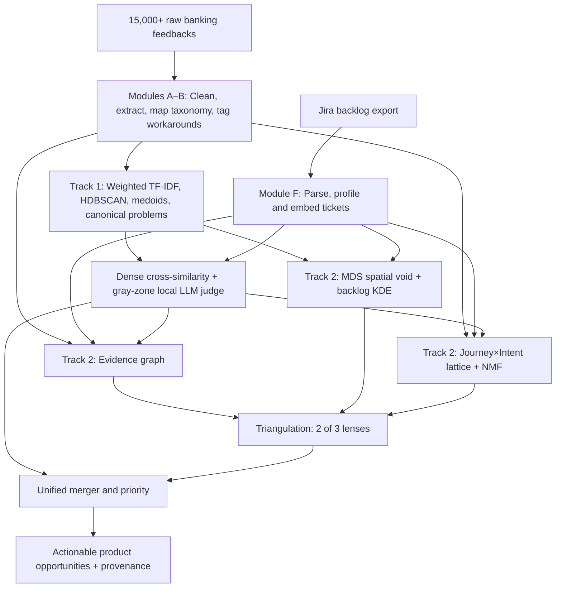
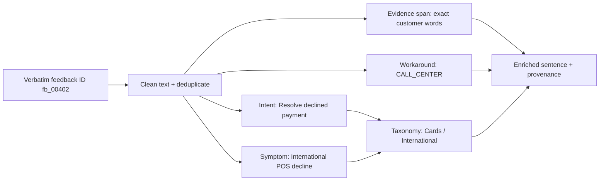
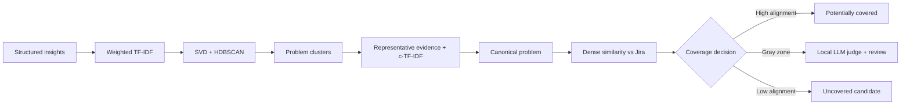
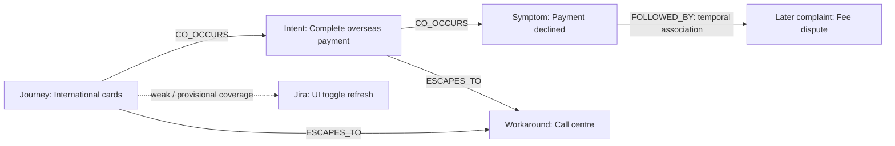
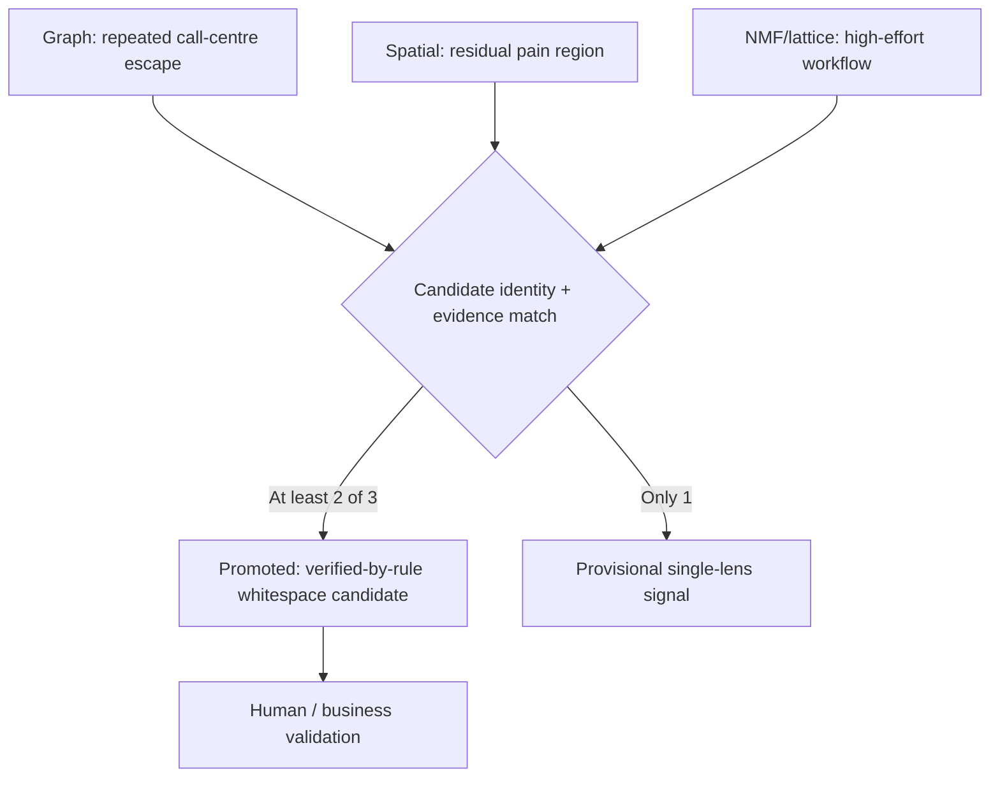
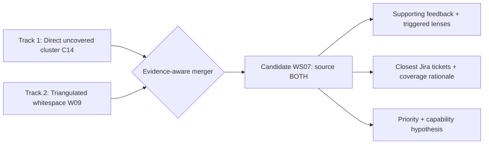
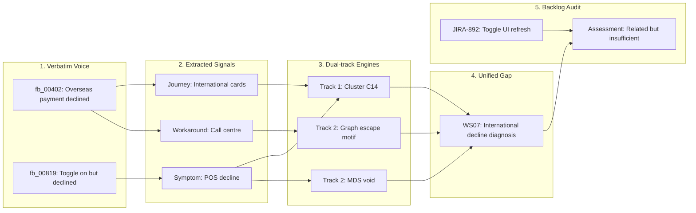
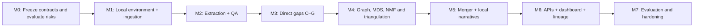

# Banking Customer Intelligence & Whitespace Discovery Platform
## Project Approach Report — Business Rationale, Analytical Methods & Sample Visuals
**Version:** 0.1 · **Date:** 16 November 2026  
**Context:** Independent project using 15,000+ banking customer feedback records and Jira engineering backlog; AICX remains backup.  
**Runtime:** Local Python/FastAPI/SQLite/React; local BERT/embeddings/LLM.  

> **Visual interpretation:** All scenarios, IDs, counts, scores and charts below are **illustrative mock examples**, not observed findings from the actual 15,000-record dataset or Jira. Mermaid diagrams render in compatible Markdown viewers (such as GitHub); text/table fallbacks are included for portability. This report explains the supplied architecture, with engineering cautions identified separately.

## 1. Executive summary

The proposed system answers a product management question: **Where is customer friction high, but existing product/engineering work is insufficient?** It does this in two ways: (1) directly clustering expressed complaints and checking Jira alignment, and (2) searching for hidden product whitespace in the structure of journeys, workarounds, time-ordered complaints, spatial representations and behavioral combinations. A unified merger turns candidates into evidence-backed backlog recommendations.

The intended output is **not** merely sentiment classification, a complaint dashboard, or a list of Jira similarities. It is a reviewable product opportunity: specific customer problem, supporting quotes, candidate Jira matches and why they do/do not resolve it, discovery source(s), priority components and testable acceptance criteria.

## 2. Business problem and proposed value

**Current analytical difficulty:** Feedback arrives as unstructured narratives across channels. Jira describes engineering work in different vocabulary. High-volume explicit complaints can be identified through clustering, but low-volume high-effort workflows, manual workarounds, and interactions between journeys can be missed. Pure vector matching may wrongly interpret a related ticket as sufficient coverage.

**Proposed value:**
- Consolidate 15,000+ feedback records into evidence-backed canonical problems.
- Audit whether Jira backlog items actually target the same customer friction.
- Detect less obvious friction patterns and potential missing capabilities.
- Produce prioritized, explainable recommendations instead of untraceable AI summaries.
- Enable reverse trace from recommendation to verbatim customer evidence.

**What it cannot prove on its own:** causal root causes, that a product capability truly does not exist, that a Jira item has shipped, or that a recommended feature is commercially optimal. Those require additional product/engineering validation.

## 3. Full architecture — sample visual 1



**How to read:** one shared extraction layer; direct discovery and structural discovery; two sets of candidates merged into a single feed. Note that some structural lenses depend on the backlog coverage outputs of Track 1, so execution is a dependency graph, not literally two fully independent workers.

## 4. Worked example — illustrative banking scenario

**Raw feedback A (fabricated):** “My international card payment failed even though international usage was on. I called support from abroad.”

**Raw feedback B (fabricated):** “I enabled overseas transactions, but the hotel payment was declined twice and I had to use another card.”

**Jira ticket (fabricated):** `JIRA-892 — Improve international card settings toggle UI`. It describes styling and labeling of the toggle, not a transaction authorization failure.

**Possible extracted signals:** Journey = Cards → International Usage; Intent = Resolve payment failure; Symptom = POS decline despite toggle enabled; Emotion = frustration; Effort = high; Workaround = call centre / alternate card; Evidence = exact quoted span. The system may form a canonical problem such as “International payments fail despite global usage being enabled.” Similarity to `JIRA-892` might be nonzero because the vocabulary overlaps, but this alone does not prove coverage.

**Illustrative product opportunity:** “Diagnose and resolve international card authorization failures.” This is a *hypothesis*, not a confirmed feature request or verified root cause.

## 5. Shared foundation — extraction visual 2



| Extracted field | Illustrative value | Why needed |
|---|---|---|
| `feedback_id` | `fb_00402` | Audit trail |
| `journey_node_id` | Cards / International | Structured product context |
| `intent` | Resolve payment failure | Functional objective |
| `symptom` | POS declined despite toggle | Observable friction |
| `effort_score` | 5/5 (illustrative) | Prioritization |
| `workarounds_json` | `CALL_CENTER` | Structural escape detection |
| `evidence_span` | “I called support from abroad” | Verifiable proof of statement |
| `enriched_sentence` | Template-based text | Controlled clustering representation |

**Method note:** Source specifies fine-tuned BERT and lexicon-based workaround tags. A trained checkpoint, annotated ground truth and confidence calibration have not yet been provided. Lexicon hits need negation handling and false-positive checks.

## 6. Track 1 — explicit direct gap discovery

### 6.1 Process visual 3



**Source baseline:** weighted TF-IDF uses taxonomy 0.40, symptom 0.35, raw cleaned text 0.25. HDBSCAN discovers clusters; top-k representative evidence and c-TF-IDF support naming. Dense embeddings align canonical problems with Jira tickets. Initial coverage thresholds: >=0.75 covered, 0.60–0.75 gray zone, <0.60 uncovered. These are candidate thresholds requiring evaluation, not verified operating points.

### 6.2 Illustrative cluster table

| Cluster | Canonical problem | Feedback count* | Mean effort* | Closest Jira* | Similarity* | Initial finding |
|---|---|---:|---:|---|---:|---|
| C14 | International POS declines despite toggle | 142 | 4.6 | JIRA-892 | 0.41 | Uncovered candidate |
| C07 | OTP delay during login | 310 | 4.0 | JIRA-510 | 0.81 | Potentially covered |
| C22 | Statements require repeated manual export | 39 | 4.7 | JIRA-302 | 0.68 | Gray zone |

*All figures and tickets fabricated for illustration.*

### 6.3 Why Track 1 is useful

Track 1 is best suited to **explicit, relatively frequent pain points** that customers describe in comparable language. It creates a direct audit trail: raw feedback → problem cluster → synthesized problem → closest Jira tickets → assessment. Its weaknesses include missed rare workflows, false grouping, overgeneralized canonical names, and semantic similarity being mistaken for actual resolution.

## 7. Track 2 — structural and behavioral whitespace

Track 2 is intended to reveal friction that may not form a strong single complaint cluster. It uses three lenses; each outputs evidence-backed *candidate signals*, not conclusive product truths.

### 7.1 Lens 1: heterogeneous evidence graph — sample visual 4



**Intended graph patterns:**

1. **Workaround escape:** high-effort complaints route to branch, support, spreadsheet or external channels without credible backlog coverage.
2. **Temporal friction chain:** the same customer reports A and later B within a configured window (7 days in source); association and lift can reveal possible cascades but not causation.
3. **Bridge nodes:** shared journey/aspect nodes connect many friction patterns and have weak coverage.

**Graph implementation caution:** The source's motif `Intent → Symptom → Workaround` is not directly supported by its listed `ESCAPES_TO` edge construction; define a consistent edge model before coding. `ADDRESSED_BY` should be provisional when based only on cosine similarity.

### 7.2 Lens 2: MDS spatial void — sample visual 5

**Conceptual schematic (not a measured plot):**

```text
              Behavioral dimension 2 (relative)
  high  ┌────────────────────────────────────────────┐
        │  ○ Problem A       ○ Problem B             │
        │        ▒▒▒▒▒▒▒▒▒▒▒▒                     ▲   │
        │       ▒ HIGH PAIN  ▒     ▲ Jira ticket     │
        │        ▒ LOW BACKLOG ▒                    │
        │          ○ Problem C          ▲           │
        │                                            │
  low   │  ○ Problem D                  ▲ Jira       │
        └────────────────────────────────────────────┘
          low     Behavioral dimension 1       high

  ○ = canonical customer problem
  ▲ = heuristically projected Jira backlog item
  ▒ = candidate residual pain / coverage void
```

**Mathematical intention:** project canonical problems into 2D using MDS of cluster behavioral distances; place backlog tickets using inverse-distance-weighted nearest-neighbor projection; estimate customer pain and backlog density using KDE; subtract coverage surface from pain surface:

\[
S_{void}(x,y)=\max\left(0,\ KDE_{pain}(x,y)-0.85\,KDE_{backlog}(x,y)\right).
\]

**Interpretation:** high residual areas may deserve investigation. A visual gap is **not proof** of a missing capability. MDS distortion, heuristic backlog projection, bandwidth and independently normalized density surfaces can produce artifacts. Assess stress, sensitivity and ground-truth validity.

### 7.3 Lens 3: taxonomy lattice + NMF — sample visual 6

**Illustrative journey × intent heatmap (counts are invented):**

| Journey \ Intent | Report bug | Request feature | Dispute fee | Seek support |
|---|---:|---:|---:|---:|
| International cards | **68 🔴** | 12 | 3 | **44 🟠** |
| Auto-pay | **41 🟠** | 18 | **27 🔴** | 9 |
| Statements | 8 | **31 🟠** | 2 | 21 |
| Account access | **105 🔴** | 7 | 0 | 35 |

**Legend:** 🔴 = illustrative high-friction/weak-coverage candidate; 🟠 = review candidate. The actual detector requires count >=10, mean effort >=3.8 and backlog alignment <0.25, so a raw count alone cannot determine color. This table is a conceptual teaching aid.

**NMF concept:** create a nonnegative matrix from one-hot/count indicators for intent, symptom, emotion, workaround and channel; factorize into document-factor weights and factor-feature weights. Inspect top contributing records and factors. For example:

```text
                 Latent behavior factor F3 (illustrative)
  CALL_CENTER         ██████████████████
  HIGH_EFFORT         ████████████████
  PAYMENT_DECLINE     ██████████████
  APP_STORE           █████████
  BRANCH_VISIT        █████
```

A factor is an *interpretable statistical co-occurrence pattern*, not necessarily a product opportunity. The source suggests 12 factors, top-50 records, effort >=4.0 and <20% covered; test the stability of these assumptions. The Poisson traffic-adjustment needs genuine traffic denominators; feedback volume alone is insufficient.

### 7.4 Cross-lens triangulation — sample visual 7



**Source baseline:** >=2 of 3 lenses, merge on shared Journey×Intent or feedback Jaccard >=0.30; composite score `.35 graph + .30 spatial + .20 combinatorial + .15*(1 − backlog coverage)`. **Critical caveat:** “verified” means passing a programmed gate, not independently proven business truth. Two correlated lenses may repeat the same bias. Shared Journey×Intent can also merge unrelated symptoms.

## 8. Unified merger and product opportunity output

### 8.1 Cross-track convergence — sample visual 8



**Three output categories:** `DIRECT_CLUSTER`, `TRIANGULATED_WHITESPACE`, `BOTH`. Cross-track matching initially uses Jaccard >=0.30 or exact Journey×Intent, but this should trigger a candidate match for semantic/evidence review rather than automatic identity.

### 8.2 Illustrative prioritized feed

| Rank* | Candidate capability | Source | Evidence* | Coverage* | Priority* |
|---|---|---|---:|---|---:|
| 1 | Diagnose overseas card declines | BOTH | 142 | No direct Jira resolution found | 0.88 |
| 2 | Explain auto-pay failures and fees | TRIANGULATED_WHITESPACE | 67 | Partial | 0.79 |
| 3 | Reduce manual statement export | DIRECT_CLUSTER | 39 | Gray zone | 0.71 |

*Rank, scores, evidence counts and decisions are fabricated for illustration. Actual cross-source scores require calibration.*

### 8.3 Example product opportunity card (illustrative)

> **Capability:** Self-service international card decline diagnosis  
> **Hypothesis:** Customers encounter overseas declines despite enabling international usage. A guided diagnosis and remediation capability may reduce repeat attempts and support calls.  
> **Evidence:** `fb_00402`, `fb_00819`, … (illustrative IDs)  
> **Jira audit:** `JIRA-892` appears related to settings UI, but does not describe authorization remediation.  
> **Acceptance criteria (draft):**
> 1. Given an eligible declined international transaction, when the customer opens card help, then the app shows an understandable decline category where available.
> 2. Given an actionable setting issue, when the customer requests help, then the app provides a safe next step.
> 3. Given an unresolved decline, when self-service cannot resolve it, then the app offers an appropriate escalation path.

These acceptance criteria are **draft product hypotheses**, not confirmed technical feasibility or compliance approval.

## 9. Evidence lineage — sample visual 9 (five-column interactive design)

The source specifies a React Flow DAG with five lanes. This is the most important explainability feature.



**Interaction specification:** selecting a gap loads its graph; clicking a cluster filters to medoid-nearest feedback; clicking a graph motif filters to workaround evidence; clicking a spatial region filters to nearby high-effort problems; clicking a verbatim feedback highlights its exact supported route to the gap and Jira assessment. Large evidence lists should be virtualized/paginated. Use solid edges for supported derivations, dashed edges for weak/rejected matches, and tooltips to explain uncertainty.

### 9.1 Five-lane text fallback

```text
[1 VERBATIM VOICE] → [2 EXTRACTED SIGNALS] → [3 DISCOVERY ENGINES] → [4 UNIFIED GAP] → [5 BACKLOG AUDIT]
 fb_00402               symptom: decline         cluster C14             WS07              JIRA-892
 fb_00819               workaround: call        graph escape            score* 0.88       similarity* 0.41
                                                  MDS void                source BOTH       related ≠ resolved
```

*Illustrative values only.*

## 10. Additional analytical views and recommended visuals

| User question | Visual | Explanation |
|---|---|---|
| Where do customers abandon app workflows and call support? | Journey → Intent → Symptom → Workaround Sankey | Volume of escape paths |
| Which early complaints precede later complaints? | Temporal friction DAG | Time-ordered associations with lift; not causation |
| Why did this candidate score highly? | Two-hop motif subgraph + score breakdown | Supporting edges, detector outputs, Jira matches |
| Which journeys show high workaround reliance? | Journey × Workaround heatmap | Concentration of manual escapes |
| Where is pain high but backlog presence weak? | MDS scatter + KDE contour | Exploratory spatial residual |
| Which behavioral combinations are emerging? | NMF factor bar chart + evidence table | Co-occurring features and supporting records |
| Can I audit the recommendation? | Five-column lineage DAG | Verbatim-to-decision traceability |

## 11. Product walkthrough for a stakeholder demo

1. **Open gap feed:** show candidate titles, source labels, evidence counts, priority components.
2. **Select a high-ranked candidate:** show its problem statement and proposed capability hypothesis.
3. **Open evidence drawer:** show verbatim customer quotes with highlighted spans and source IDs.
4. **Inspect direct track:** show cluster size, representative examples and nearest Jira tickets.
5. **Inspect structural track:** show triggered graph motifs, MDS region and/or NMF factor, each with evidence.
6. **Open lineage canvas:** trace a selected feedback record across extraction, discovery, unified gap and backlog audit.
7. **Export draft recommendation:** CSV/JSON with capability, hypothesis, acceptance criteria, evidence IDs and unresolved review questions.

**Suggested demo narrative:** “We are not claiming the system knows what to build. It surfaces candidate customer needs that the current Jira backlog may not adequately address, shows which analytical methods flagged them, and provides the evidence a product owner needs to decide.”

## 12. Source-preserving approach versus necessary validation

| Source-specified method | Intended contribution | Key validation question |
|---|---|---|
| Weighted TF-IDF | Explicit complaint similarity | Does weighting overfit taxonomy labels? |
| HDBSCAN | Granular complaint groups | Are clusters coherent and stable? |
| Medoid + LLM synthesis | Readable canonical problems | Are names faithful to member evidence? |
| Dense Jira matching | Coverage candidates | Does matching reflect actual resolution? |
| Evidence graph | Workarounds and friction chains | Are edges/motifs valid and temporally grounded? |
| MDS + KDE | Residual pain regions | Are regions stable under projection/bandwidth changes? |
| NMF + lattice | Hidden combinations | Are factors interpretable and not artifacts? |
| 2-of-3 triangulation | Multi-view agreement | Are detectors truly complementary? |
| Unified scoring | Product prioritization | Are scores comparable and business meaningful? |

## 13. Implementation approach, milestones and deliverables



**M0:** actual source schemas, taxonomy, local hardware, BERT/model availability, schema consistency, scalable distance plan, graph schema, scoring semantics and evaluation dataset.  
**M1–M2:** validated and traceable ingestion/extraction.  
**M3:** evidence-backed direct problem clusters and Jira coverage candidates.  
**M4:** three independent structural detectors and evidence-aware triangulation.  
**M5:** merged, scored, reviewable opportunity feed.  
**M6:** user-facing analytical dashboard with lineage.  
**M7:** measured quality, stability, performance, security and documented limitations.

**Dependency rule:** do not build the spatial/graph visual merely because it looks compelling; validate the analytical output it represents first.

## 14. Success criteria

The project is successful when a product owner can take a candidate from the feed, inspect the original customer evidence, understand how it was discovered, see which Jira items were evaluated and why, distinguish uncertainty from fact, and make an informed backlog decision. Engineering success also requires reproducible runs, controlled model versions, traceable IDs, validated extraction, reasonable performance on the full dataset, and documented false positives.

## 15. Open decisions and immediate inputs

- Actual feedback CSV/JSON schema and representative records.
- Jira export schema, issue statuses and text quality.
- Taxonomy YAML/version.
- Local CPU/RAM/GPU and available model weights.
- Labeled extraction and problem↔Jira evaluation samples.
- Security/privacy handling of banking free text.
- Whether channel traffic/exposure denominators exist for Poisson adjustment.

**Closing assessment:** The strongest distinguishing feature is the combination of **direct semantic gap discovery**, **orthogonal structural whitespace analysis**, and **verbatim evidence lineage**. Its credibility depends less on the number of algorithms than on whether each output is reproducible, accurately interpreted and supported by source records.

---
**Source basis:** User-supplied 624-line “Unified End-to-End Architecture,” including Modules A–H, mathematical definitions, API/UI specifications, graph recommendations and React Flow lineage example. Companion document: `Project_Implementation_Blueprint.md`.
